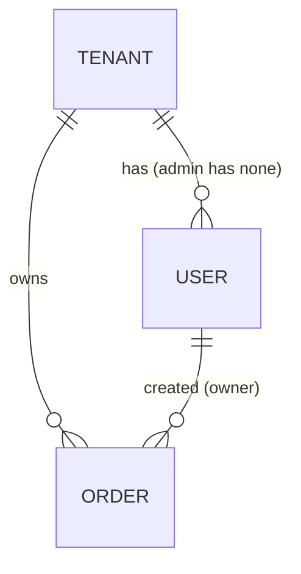

# Domain model

## Entities

| Entity | Purpose | Key attributes | Source |
|---|---|---|---|
| Tenant | the company a user and their orders belong to | name (`tenant-a`, `tenant-b` as examples) | [S01 L16-L17] |
| User | a person who signs in | username, tenant (none for the admin), role | [S01 L16; S01 L18; S04 L8-L15] |
| Order | what a customer places and follows | id, owner, tenant, note, status | [S01 L22-L23] |
| Token | the sign-in credential | valid 60 minutes from issue | [S01 L59] |

### Order attributes

| Attribute | Rule | Source |
|---|---|---|
| id | assigned by the service, starts at 1, +1 per order | [S01 L27] |
| owner | the username that created the order | [S01 L22] |
| tenant | the owner's tenant | [S01 L22] |
| note | free text, at most 200 characters; longer input is cut to 200, not rejected | [S01 L25] |
| status | one of `new`, `paid`, `shipped`, `cancelled`; created as `new`; only the service changes it | [S01 L33; S01 L29; S01 L39] |

## Relationships



- A user belongs to exactly one tenant, except the admin, who belongs to none [S01 L16].
- An order's tenant is its owner's tenant [S01 L22].

## Order lifecycle

```mermaid
stateDiagram-v2
    [*] --> new : created
    new --> paid : payment confirmed
    paid --> shipped : manager marks shipped
    new --> cancelled : customer cancels (PRD; disputed, C-1)
    paid --> cancelled : customer cancels (PRD; within 24 h per D-01)
    new --> expired : expires (D-02, time TBD, not in PRD)
    shipped --> [*]
    cancelled --> [*]
```

Mermaid state diagrams have no dashed edge, so the two disputed edges carry their finding in the label; the text
below is what the sources say.

| From | To | Trigger | Stated by | Status | Source |
|---|---|---|---|---|---|
| — | `new` | an order is created | PRD | stated | [S01 L29] |
| `new` | `paid` | the payment provider confirms payment; until a provider exists, a manager through an internal tool | PRD | stated, provider open (OQ-01) | [S01 L35; S01 L63-L64] |
| `paid` | `shipped` | a manager of the tenant marks it shipped | PRD | stated; the roles sheet lets no role change a status (C-2) | [S01 L36; S04 L37] |
| `new` | `cancelled` | customer cancels | PRD, FAQ | **disputed**: S02 D-02 says a `new` order expires instead (C-1) | [S01 L37; S03 L23; S02 L28] |
| `paid` | `cancelled` | customer cancels | PRD, FAQ, S02 | **disputed window**: PRD any time before shipped; S02 D-01 only within 24 hours of payment, then 409 (C-1) | [S01 L37; S03 L23-L24; S02 L25-L26] |
| `new` | expired | time passes; the time is TBD | S02 only | decided in S02, absent from the PRD; the resulting status name is not stated | [S02 L28-L29] |
| `shipped` | any | — | PRD, FAQ | forbidden: final | [S01 L38; S03 L23-L24] |
| `cancelled` | any | — | PRD, FAQ | forbidden: final; "A cancelled order stays cancelled" | [S01 L38; S03 L27] |

Forbidden by every source: a client setting `status` in an update request — 400 with the rejected field names
[S01 L39-L40]; the matrix gives "change the status" to no role [S04 L37].

## Derived values

None. Pricing, stock, invoices and refunds are out of scope for v1 [S01 L12].
