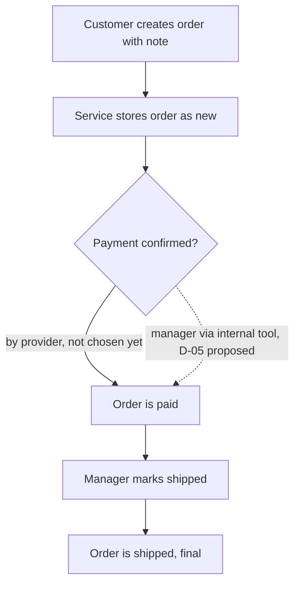

# Place and ship an order

**Trigger:** a customer of a tenant wants to place an order [S01 L9] · **Actors:** customer, payment provider
(not chosen yet [S01 L63]), manager · **Outcome:** an order in status `shipped` [S01 L36] ·
**Related:** [order lifecycle](../domain-model.md#order-lifecycle)

## Steps

1. The customer signs in ([flow 03](03-sign-in-with-lockout.md)) and creates an order with a note [S01 L9; S03 L10].
2. The service assigns the next id (from 1, +1 per order) [S01 L27], sets owner and tenant from the caller
   [S01 L22], cuts a note longer than 200 characters to 200 [S01 L25], and stores the order as `new` [S01 L29].
3. The customer may change the note at any time; nothing else [S03 L14; S01 L44].
4. The payment provider confirms payment and the order becomes `paid` [S01 L35]. Until a provider exists, a
   manager sets `paid` through an internal tool [S01 L64] — proposed as D-05, not decided [S02 L46-L47].
5. A manager of the tenant marks the order shipped; it becomes `shipped`, a final state [S01 L36; S01 L38].

## Diagram

The dashed edge is the interim path the PRD describes and S02 has not decided [S01 L64; S02 L46-L47].

## Rules on the way

| Step | Rule | Source |
|---|---|---|
| 2 | FR-ORD-02 note at most 200 characters, cut not rejected | [S01 L25] |
| 2 | FR-ORD-03 id sequence; FR-ORD-04 created as `new` | [S01 L27; S01 L29] |
| 2, 4, 5 | BR-ORD-05 a client sending `status` gets 400 with the rejected field names | [S01 L39-L40] |
| 4 | BR-ORD-01 `new` → `paid` on provider confirmation | [S01 L35] |
| 5 | BR-ORD-02 `paid` → `shipped` by a manager of the tenant; the matrix lets no role change a status (C-2) | [S01 L36; S04 L37] |

## Alternative and error paths

- An admin cannot create an order: 403 [S01 L46; S04 L57].
- A note of 201 characters is stored as its first 200 characters [S01 L71].
- The warehouse picks paid orders before the status is set to shipped, "sometimes the next day" [S02 L20-L21] —
  the gap between the real shipment and the status is the reason for the cancellation window (flow 02).
- **Not stated:** what the customer calls to pay, and what happens when payment fails (OQ-01; gap G-2).
- **Not stated:** whether a manager marks shipped through the API (the matrix says no role changes a status
  [S04 L37]) — conflict C-2, KQ-2.

## Data touched

Order (created as `new`, then `paid`, then `shipped`) [S01 L29; S01 L35-L36].

## Sources

S01 §1 (L9), §3 (L22-L29), §4 (L35-L36), §7 (L63-L64); S02 D-05 (L46-L47); S03 Placing an order (L10-L18);
S04 Matrix (L33-L37).
