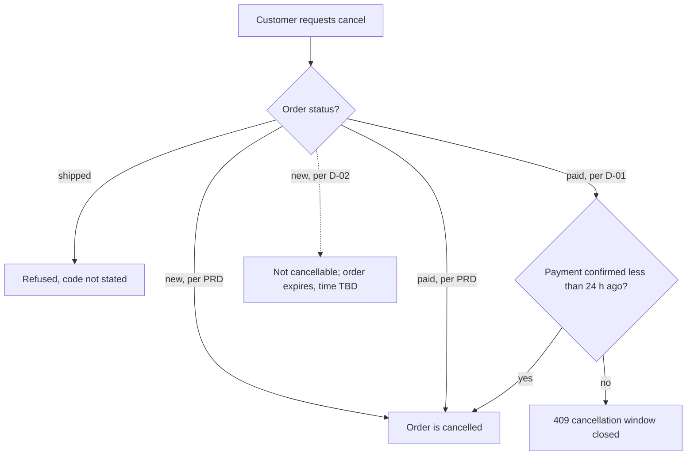

# Cancel an order

**Trigger:** a customer no longer wants an order [S03 L22-L23] · **Actors:** customer · **Outcome:** the order is
`cancelled` (final) [S01 L38], or the request is refused · **Related:** [order lifecycle](../domain-model.md#order-lifecycle),
[C-1](../analysis.md#conflicts)

The rule for this flow is disputed between the PRD (draft, 2026-10-20) and the sync of 2026-10-28; both versions
are shown. QA's own action from the sync is to wait for the PRD update before writing cancellation cases
[S02 L54].

## Steps — as the PRD and the FAQ say

1. The customer opens the order and chooses "Cancel" [S03 L23].
2. If the order is `new` or `paid`, it becomes `cancelled` [S01 L37].
3. If the order is `shipped`, the cancel is refused [S01 L37; S03 L23-L24]. The response code is **not stated**.
4. A cancelled order stays cancelled [S03 L27; S01 L38].

## Steps — as decided on 2026-10-28 (D-01, D-02)

1. The customer requests cancellation of a `paid` order.
2. If the payment was confirmed less than 24 hours ago, the order becomes `cancelled` [S02 L25].
3. Otherwise the request answers 409 `cancellation window closed`, even if the order is still `paid` [S02 L25-L26].
4. A `new` (unpaid) order is not cancelled by the customer; it expires after a time that is TBD [S02 L28-L29].

## Diagram

The `new` branch under D-02 is dashed because the sources do not say what the cancel request answers in that
case *(inferred from [S02 L28])*.

## Rules on the way

| Step | Rule | Source |
|---|---|---|
| PRD 2-3 | BR-ORD-03 cancel while `new` or `paid`, never `shipped` | [S01 L37] |
| D-01 2-3 | 24-hour window after payment confirmation; 409 after it | [S02 L25-L26] |
| D-02 4 | `new` orders expire instead of being cancelled | [S02 L28-L29] |
| 4 | BR-ORD-04 `cancelled` is final | [S01 L38] |

## Alternative and error paths

- Cancel by mistake cannot be undone; the customer places a new order [S03 L27].
- **Not stated:** whether a manager or an admin may cancel; the matrix has no cancel row [S04 L30-L40] (gap G-4).
- **Not stated:** what a cancellation of a `paid` order does to the money; refunds are "separate services"
  [S01 L12] (risk R-2, KQ-4).
- **Not stated:** the response when a `shipped` order is cancelled (PRD step 3) and when a `new` order is cancelled
  under D-02 (gap G-6).
- Race the sync describes: the warehouse picks a paid order before the status is set to shipped, so a customer can
  cancel an order that is physically on its way [S02 L20-L21].

## Data touched

Order.status (`cancelled`) [S01 L37-L38]; under D-02, an expired `new` order whose resulting status is not named
[S02 L28].

## Sources

S01 §4 (L37-L38); S02 §2 (L20-L31), Actions (L54); S03 Cancelling (L22-L27); S04 Matrix (L30-L40).
