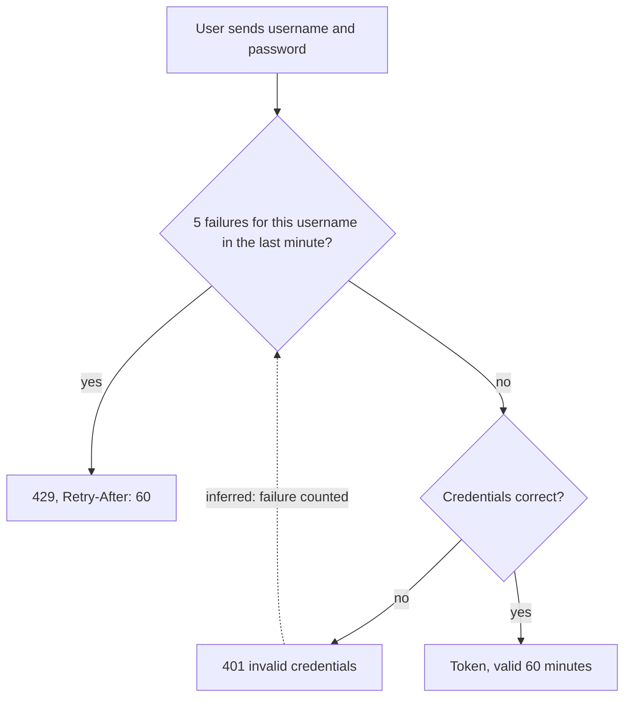

# Sign in, with lockout

**Trigger:** a user wants a token [S01 L59] · **Actors:** any user (customer, manager, admin all sign in
[S04 L32]) · **Outcome:** a token valid for 60 minutes [S01 L59], or 401, or 429 · **Related:**
[denial codes](../actors-and-permissions.md#denial-codes)

## Steps

1. The user sends a username and a password.
2. If the service has already counted 5 failed sign-ins for that username within the last minute, it answers 429
   with `Retry-After: 60` until the minute has passed [S01 L57-L58].
3. Otherwise, with a wrong username or a wrong password, it answers 401 with `invalid credentials`; the two cases
   are not distinguishable from the response [S01 L55-L56]. The failure counts towards step 2 *(inferred from
   [S01 L57])*.
4. With correct credentials it answers a token valid for 60 minutes from issue [S01 L59].
5. A request without a token, or with an invalid or expired token, answers 401 [S04 L21].

## Diagram

## Rules on the way

| Step | Rule | Source |
|---|---|---|
| 2 | NFR-SEC-02 lockout: 5 per username per minute, 429, `Retry-After: 60` | [S01 L57-L58; S02 L35] |
| 3 | NFR-SEC-01 same 401 message for wrong username and wrong password | [S01 L55-L56; S03 L41-L42] |
| 4 | NFR-SEC-03 token valid 60 minutes | [S01 L59] |
| 5 | 401 for no, invalid or expired token | [S04 L21] |

## Alternative and error paths

- The FAQ tells customers the block lasts "15 minutes" after "several wrong attempts" [S03 L41]; the sync confirmed
  the PRD's numbers and support is to fix the FAQ [S02 L35-L36; S02 L52] — stale, not a rule change.
- The FAQ says a sign-in lasts "About an hour" [S03 L45]; the PRD says 60 minutes [S01 L59].
- **Not stated:** whether a successful sign-in clears the failure count, and whether the count is per username
  only or also per client address (gap G-7).

## Data touched

Failed-sign-in count per username (a value the rule implies; no source names where it is kept) *(inferred from
[S01 L57])*; token [S01 L59].

## Sources

S01 §6 (L55-L59); S02 §3 (L35-L36); S03 Signing in (L40-L45); S04 Response codes (L21), Matrix (L32).
