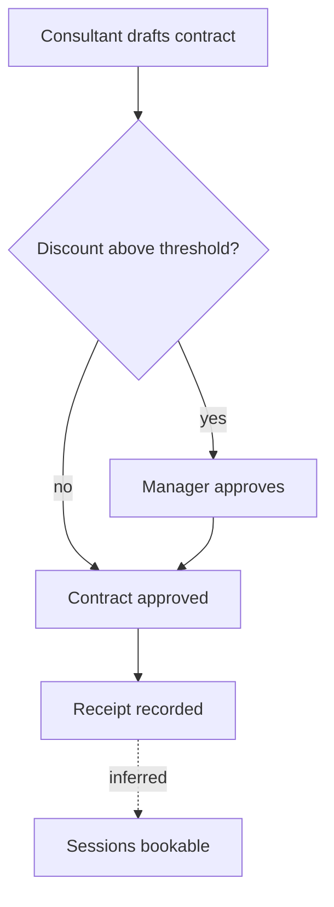

# Flows and Models

How to get business flows, lifecycles, roles and data out of prose documents, and how to draw them so a reader sees
what the sources say — and only that.

Contents:

- [Finding flows](#finding-flows)
- [Flow page template](#flow-page-template)
- [Diagram conventions](#diagram-conventions)
- [Lifecycles](#lifecycles)
- [Actors and permissions](#actors-and-permissions)
- [Domain model](#domain-model)
- [Stated vs inferred](#stated-vs-inferred)

---

## Finding flows

A flow is a sequence with a trigger, at least one actor, steps, and an outcome. They hide in:

| Where | Signal |
|---|---|
| Business-flow / process documents | numbered steps, "then", "after", swimlanes |
| Requirements and user stories | "As a … I want … so that …", acceptance criteria with Given/When/Then |
| Business rules | "when X, Y happens", "only after", "requires approval" |
| Status / lifecycle sections | status lists and allowed transitions |
| Screens and wireframes | buttons that move a record to the next state, wizards |
| API specs | endpoint sequences (create → approve → pay) |
| Meeting notes and decisions | "we decided that after … the …" |

Collect every candidate in the digests, then merge: the same flow described in a flow document, three rules and an
acceptance criterion is **one** flow page citing all of them. Name flows after the business outcome ("Sell a
contract"), not the screen.

---

## Flow page template

```md
# Sell a PT contract

**Trigger:** a customer agrees to buy a package [S05 L40] · **Actors:** Consultant, Manager, Accountant ·
**Outcome:** an approved, paid contract with sessions to book [S05 L52] · **Related:** [lifecycle](../domain-model.md#contract)

## Steps
1. Consultant creates a draft contract for the customer and package [S05 L41].
2. If the discount is above the role's threshold, a manager approves it [S07 L92; S10 L60].
3. …

## Diagram
<Mermaid flowchart or sequence diagram — conventions below>

## Rules on the way
| Step | Rule | Source |
|---|---|---|
| 2 | Discount above threshold needs approval | BR-213 [S07 L92] |

## Alternative and error paths
- Approval rejected → contract kept as REJECTED, not deleted [S07 L96].
- **Not stated:** what happens when payment fails (gap → analysis KQ-14).

## Data touched
Contract (created, approved), Payment (recorded), Session credit (created) [S06 L120-L140].

## Sources
S05 §Flow 4 (L38-L60), S07 BR-210–BR-215, S15 AC-11
```

---

## Diagram conventions

- **Flowchart** (`flowchart TD`) for steps with decisions; **sequence** (`sequenceDiagram`) when the point is who
  talks to whom (people, systems, devices); **state** (`stateDiagram-v2`) for lifecycles; **ER** (`erDiagram`) for
  the domain model.
- Node text in the product's words; one verb per step; decisions as questions (`{Discount above threshold?}`).
- Inferred steps and edges are dashed (`-.->`) and labelled `inferred`; never draw a path the sources don't
  support as a solid line.
- Keep a diagram under ~20 nodes; split by sub-flow and link the pages.
- Every diagram is followed by the numbered steps with citations — the diagram is a picture of the text, not a
  replacement for it.



---

## Lifecycles

For every entity with a status: the states, the allowed transitions with who/what triggers them, the forbidden
transitions the sources state ("cannot cancel a trained session"), and terminal states. Draw `stateDiagram-v2`; put
a transition table under it with sources. A transition mentioned only as forbidden is still listed (it is a rule
and a test).

---

## Actors and permissions

- One row per role: purpose, typical tasks, data scope (own / branch / all), sources.
- The permission matrix as the sources give it (role × capability); where sources give only examples, say so.
- Approvals: what needs approval, by whom, thresholds.
- Distinguish **roles** (permission sets) from **job titles** and from **system actors** (scheduler, import job,
  device bridge).

---

## Domain model

Entities with their purpose and key attributes (the ones rules and flows use — not every column), relationships with
cardinality, and derived values (how a total or balance is computed). An `erDiagram` for the core; prefer the data
model document's names, and list where documents name the same thing differently (glossary "also called").

---

## Stated vs inferred

| Write | When |
|---|---|
| plain statement + citation | the source says it |
| *(inferred from [S03 L40], [S07 L12])* | it follows from cited statements; say what it is inferred from |
| "**Not stated**" + an OQ in analysis | the reader needs it and no source says it |

A KB that marks its inferences is trusted; one that blends them in is not.
